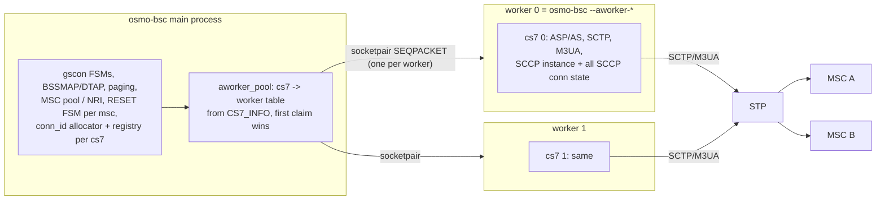
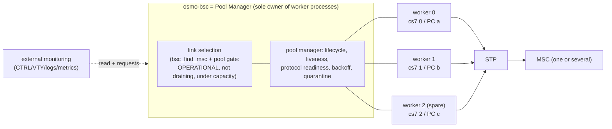
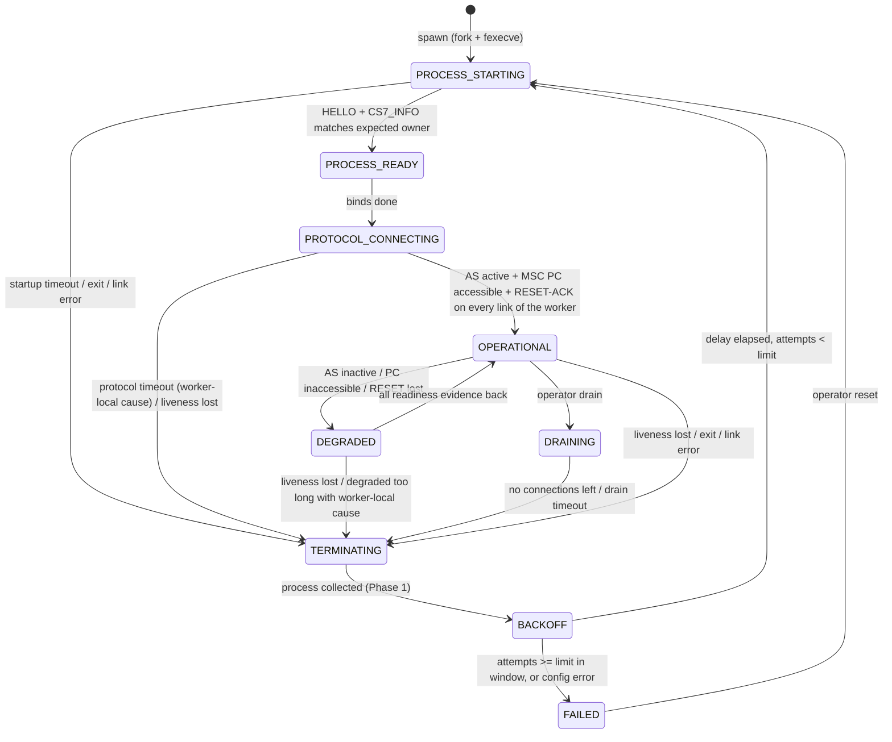
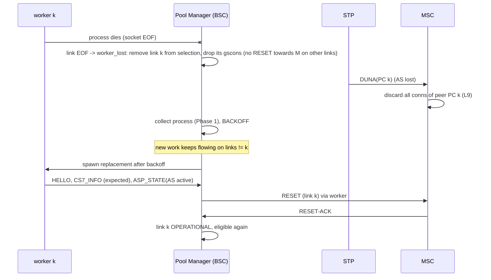

# A-worker pool, Phase 2: architecture investigation and design

Status: **proposal for review**. Nothing in this document is implemented. Phase 1 is committed as `e54578f2c` on
`a-worker-pool` (unpushed).

> **Revision note: current target architecture (after 2a-5, HEAD `fa01448ea`).** The **current target** for BSC
> crash survival is `PHASE2_SUPERVISOR.md` (revision 3):
> * a standalone Supervisor executable `bsc-aworker` (`src/a-worker/`) owns the worker lifecycle;
> * `osmo-bsc` is a separate client process;
> * `osmo-bsc.cfg` is the single persistent configuration source;
> * no systemd or DevOps work is in the A-worker team's scope.
>
> This was decided as approved direction D-S11. This document is kept as the historical investigation, and it
> describes the in-process pool (osmo-bsc as the workers' parent). That pool is implemented (Phase 1, 2a-1…2a-5)
> and remains the default "legacy mode" until the Supervisor architecture passes its acceptance (S7). Where this
> document says the BSC owns, spawns or supervises workers, that holds for legacy mode only; in supervisor mode the
> Supervisor does. §17 is superseded as noted there. The models, recovery questions, scheduling, connection-loss
> analysis and the 2b–2e designs remain valid.
>
> **Status (2026-11-19, after S2-5):** S1, S2-1 and S2-2 are accepted: the inline form and worker configuration
> snapshots work in legacy mode, with osmo-bsc the workers' parent. S2-3 adds the standalone Supervisor `bsc-aworker`,
> which runs the pool on its own, without osmo-bsc. S2-4 adds IPC protocol 2.0 (versions, identity, message classes,
> descriptor passing). S2-5 adds the Supervisor's session socket, BSC sessions with ATTACH/DETACH of the workers' data
> links, fencing and the operator channel (`bsc-aworker --control`); osmo-bsc does not use them yet (its session
> client is S2-7). Record: `PHASE2_IMPLEMENTATION_PLAN.md` §12 and §14.5–§14.8.

Baseline inspected:

| Component | Version / commit | Where |
|---|---|---|
| osmo-bsc (`a-worker-pool`) | `e54578f2c` = Phase 1 on top of `1c880676a`, which is 4 commits on the 1.15.0 pin `1a2627f61` | `~/dev/osmo-bsc-a-worker-pool` |
| libosmo-sigtran (contains SCCP; there is no separate libosmo-sccp any more) | 2.3.0 | `~/dev/gsm/libs/libosmo-sigtran` |
| libosmo-netif | 1.8.0 | `~/dev/gsm/libs/libosmo-netif` |
| libosmocore | 1.14.2 | `~/dev/gsm/libs/libosmocore` |
| osmo-msc (peer behaviour) | 1.16.0 | `~/dev/gsm/apps/osmo-msc` |

Labels: **[V]** verified in source (path:line) or in the Phase 1 end-to-end run; **[I]** inference from verified
facts; **[P]** proposed change; **[Q]** open question. Line numbers refer to the commits above.

---

## 0. Summary

* **Recommended architecture: "static ownership, many links".** Every worker owns exactly one cs7 instance, i.e.
  one A link (one BSC point code, one M3UA association). An MSC is reached over *several* such links. New work is
  steered at creation time to a healthy, operational, least-loaded link. Failed workers are replaced automatically,
  with backoff and a per-worker terminal state. This is Model 1 refined, with a real pool manager.
* **Allocation unit: the new SCCP connection, placed on an A link** (= cs7 instance = worker). Nothing smaller can be
  placed (one SCCP instance per point code), and nothing existing can be moved (§4, §8).
* **Existing connections of a crashed worker are lost: transactions, SMS in flight and established calls.** That
  is forced by two independent mechanisms: the BSC drops them (`a_worker_unavailable`) and the MSC drops them when
  the STP announces the BSC point code unavailable (DUNA → `ran_peer_discard_all_conns`). Both are verified in
  source and were observed live in the Phase 1 run.
* **Active-call continuity is not feasible with the current stack.** The only technically credible route
  (Model 5) needs new libosmo-sigtran APIs and an STP AS with two ASPs per point code. It is a research item, not
  part of the recommended plan.
* **Prerequisite bug fix:** to reach one MSC over several links, `get_msc_by_addr()` must match by (cs7 instance,
  address). That's 3 call sites, and the fix is upstreamable (§11).

---

## 1. Current architecture (from source)



| Fact | Evidence |
|---|---|
| Worker = fork + fexecve of the osmo-bsc image, socketpair IPC, PDEATHSIG + parent check | `aworker_pool.c` `worker_spawn` :1034, `child_exec_worker` :966 [V] |
| A worker owns whole cs7 instances read from its config file; ownership is announced in `CS7_INFO`; a second claim closes the claimant's link | `aworker.c` `cs7_collect` :521, `encode_cs7_info` :641; `aworker_pool.c` `handle_cs7_info` :605 [V] |
| Routing main→worker by cs7 instance, only to READY workers | `worker_by_cs7` :251 [V] |
| IPC records scoped to (worker, current user_ref) | `user_by_ref` :279, fresh ref per bind in `user_try_bind` :317 [V] |
| Main allocates SCCP conn ids; worker refuses an id its SCCP instance already uses | `bsc_sccp.c` `bsc_sccp_inst_next_conn_id` :104; `aworker.c` `handle_tx` :327 (CONN_ID_IN_USE) [V] |
| Loss of a worker = all SCCP conns of its cs7 instances dropped, RESET FSM to DISC | `osmo_bsc_sigtran.c` `a_worker_unavailable` :705 → `osmo_bsc_sigtran_reset` :664 [V] |
| Phase 1 lifecycle: TERMINATING, non-blocking collection, respawn only after collection, policy after collection | `worker_lost` :563, `worker_begin_termination` :523, `reap_timer_cb` :483, `worker_collected` :441, `worker_apply_policy` :399 [V] |
| Workers forward N-STATE / N-PCSTATE / N-NOTICE upward | `aworker.c` `worker_sap_up` :207 [V] |
| "READY" = IPC handshake + CS7_INFO, sent right after config parse and SCCP setup, **independent of ASP state** | `aworker_run` :692 → `send_cs7_info` :661; observed live: first RESET of a replacement fails with "no route" [V] |
| No liveness: `ECHO_REQ` is answered by the link, never sent by anyone | `aworker_ipc_link.c` :266 [V] |
| Startup timer armed only at pool start | `aworker_pool_start` :1165 (schedule), `startup_timer_cb` :1091 [V] |
| GOODBYE lost at stop: `aworker_ipc_link_free` closes the iofd at once, dropping the queued record | `aworker_ipc_link.c` :501-510; live: workers exit 67 instead of 0 [V] |
| No connection count per cs7 (registry is a bare rb-tree) | `bsc_sccp.c` :49-84 [V] |

---

## 2. Library and peer facts that bound every design

| # | Fact | Evidence |
|---|---|---|
| L1 | The SCCP connection id **is** the on-wire source local reference | `libosmo-sigtran/src/sccp_scoc.c` :169-170, :301, :317-318, :339-340 [V] |
| L2 | Connection state = local/remote ref, remote PC, addresses, class, tx SLS, FSM state, timers (`t_conn`, `t_ias`, `t_iar`, `t_rel`, `t_int`, `t_rep_rel`). Private header; the only exported connection symbol is `osmo_sccp_conn_id_exists` | `src/sccp_connection.h` :10-62; `nm -D libosmo-sigtran.so` [V] |
| L3 | SCU primitives carry neither the remote reference nor the SLS | `include/osmocom/sigtran/sccp_sap.h` :197-227 [V] |
| L4 | An SCCP instance without the connection answers IT with ERR, discards DT1, answers RLSD with RLC (Q.714 B.2) | `sccp_scoc.c` `sccp_scoc_rx_unass_local_ref` :647-679 [V] |
| L5 | Each side derives a connection's SLS from **its own** local reference | `sccp_connection.c` `sccp_conn_gen_tx_co_mtp_sls` :104-116 [V] |
| L6 | STP loadshare picks the ASP by (OPC, SLS) → inbound messages of one connection go wherever the **MSC's** reference hashes | `ss7_as.c` `ss7_as_select_asp_loadshare` :550 [V] |
| L7 | Dynamic RKM without RCTX creates a new AS per registration, even for the same DPC; a lost dynamic ASP is destroyed, then its AS | `xua_rkm.c` :230-299; `ss7_asp.c` :1395-1404; `ss7_as.c` :326-331 [V] |
| L8 | When an AS goes down the STP sends DUNA to every active remote ASP | `xua_snm.c` `xua_snm_pc_available` :223-246 [V] |
| L9 | osmo-msc: PC inaccessible → `ran_peer_discard_all_conns` + WAIT_RX_RESET; RESET also discards all | `osmo-msc/src/libmsc/sccp_ran.c` :93-175; `ran_peer.c` [V]. Live: MSC-B logged "now unreachable: N-PCSTATE … INACCESSIBLE" at the instant worker 1 was killed |
| L10 | A client ASP always creates its own socket; no API to adopt an existing SCTP association | `ss7_asp.c` :824 (`osmo_stream_cli_create`) [V] |
| L11 | SCCP timer defaults: conn-est 60 s, T(ias) 7 min, T(iar) 15 min, rel 10 s | `sccp_instance.c` :59-65 [V] |
| L12 | Connections are protocol class 2 (no sequence numbers, no flow control) | `sccp_helpers.c` :133, :263 [V] |
| L13 | Exported state queries a worker can use: `osmo_ss7_as_active`, `osmo_ss7_asp_active`, `osmo_ss7_as_find_by_proto`, `osmo_ss7_instance_destroy` | `include/osmocom/sigtran/osmo_ss7.h` :51, :235, :288; `nm -D` [V] |
| L14 | BSC MSC selection: skips links whose RESET isn't acknowledged; NRI overlap allowed (first match wins); fallback round-robin | `gsm_08_08.c` `is_msc_usable` :162, `bsc_find_msc` :177; `bsc_vty.c` :3474-3485 [V] |
| L15 | osmo-msc pages every peer whose cells match; osmo-bsc absorbs duplicate paging per BTS | `ran_peer.c` :711-742; `paging.c` :514-516 [V] |
| L16 | RTP never passes through a worker (BTS ↔ MGW ↔ MSC side) | osmo-bsc/osmo-mgw architecture [V]; consequence [I] |
| L17 | Kernel SCTP answers heartbeats itself: a **hung** worker's association stays up, and the STP keeps routing to it | general Linux SCTP behaviour [I]; must be tested (§15) |

---

## 3. Five separate recovery questions

| | Question | Current state | Recommended design |
|---|---|---|---|
| 1 | Process recovery | Phase 1: collection, then respawn [V] | + liveness, backoff, retry limit, worker-local FAILED (§6) |
| 2 | CS7/ASP/SCTP link recovery | Replacement re-registers, RESET recovers (≈2 s + restart delay, live) [V] | Gate admission on protocol readiness (§6) |
| 3 | New SCCP connection assignment | Selection by MSC/NRI/round-robin; unaware of worker state beyond RESET [V] | Health/capacity-aware link selection (§8) |
| 4 | Recovery of an interrupted SCCP connection | Impossible (L2, L3, L4, L9) [V] | Not offered; connections fail fast and cleanly (§9) |
| 5 | Continuity of an established call | Impossible today (same reasons) [V] | Research only (Model 5, §10) |

---

## 4. The five models

### Model 1: static cs7-to-worker ownership (today)
* **Isolation:** per worker = all its cs7 instances. One cs7 per worker gives the smallest domain [V/I].
* **Capacity:** a worker is useful only if it owns a cs7 instance. **With one cs7 instance only, extra workers
  add nothing**: a cs7 instance has one SCCP instance and one local-reference space (`aworker_pool.h` ownership
  model; L1) [V].
* **Simplicity:** high; already built and live-tested [V].
* **Continuity:** none [V].

### Model 2: dynamic cs7 assignment
* A worker reads its cs7 configuration from a file at startup only (`aworker_run` :692 → `vty_read_config_file`);
  it has no VTY and no IPC message to add an instance at runtime [V]. Runtime add/remove inside a worker would need
  a new IPC command and `osmo_ss7_instance_destroy` (L13) [P], all feasible but new.
* **Moving** a cs7 instance moves no state: the new owner opens a new SCTP association (L10), registers a new AS
  (L7), the old AS disappears → DUNA (L8) → MSC discards all connections (L9), then RESET. Moving = restarting the
  link [V/I].
* So "dynamic assignment" only means *which process runs which link next*. That's useful for packing spare capacity,
  not for continuity or load. **Not recommended** beyond spawning replacements (which is already this) [I].

### Model 3: SCCP connection-level distribution across workers sharing one point code
* All workers would need to be ASPs of one AS. Inbound CO messages are distributed by the STP using the MSC's SLS
  (L5, L6), not by which worker holds the connection. A worker receiving a message for an unknown reference
  discards DT1 or answers IT with ERR (L4), which releases the call.
* Making it work needs either a demultiplexer that forwards raw SCCP between workers (no library hook exists, L2)
  or STP steering by destination local reference (not available, L6).
* Separate SCCP instances on one point code would also collide in the local-reference space (L1).
* **Not feasible** with the current stack [V/I].

### Model 4: stable signalling anchor + workers
* The anchor must hold SCTP, M3UA and SCCP with all connection state (L2, L10). That is **exactly the role the
  current worker already has**. Whatever is left for "workers" (BSSAP/DTAP) sits in the BSC, and moving it out
  would rewrite the subscriber-connection model.
* The anchor is a single point of failure for all links it carries. It only moves the problem [I].
* **Not recommended.**

### Model 5: active/standby with replicated SCCP state
Requirements, all of which must hold (derived in §10):
1. The BSC point code stays reachable through the failure: **one AS, two ASPs (active + standby), override mode,
   shared RCTX**, statically configured at the STP or registered with a fixed RCTX (L7, L8).
2. The standby's SCCP instance already holds every connection: local/remote ref, addresses, class, SLS.
   **Needs new libosmo-sigtran API** to export and import a connection (L2, L3).
3. One owner for timers T(ias)/T(iar); the standby suppresses them until takeover (L11).
4. The BSC must neither drop its gscons nor send RESET on failover (today it does both, `a_worker_unavailable`).

* **Feasibility:** library work plus STP configuration. State is small (class 2, L12); SLS is reproducible (L5).
* **Remaining loss:** messages in flight inside the dead worker. BSSAP procedures with running timers may still
  fail.
* **Realistic production design?** Not before a prototype proves it, and the library change is accepted upstream
  [Q].

### Comparison

| | M1 static | M2 dynamic cs7 | M3 conn-level | M4 anchor | M5 replicated |
|---|---|---|---|---|---|
| Works with current code | **yes** | partly (spawn only) | no | no (no gain) | no |
| Isolation | per worker | per worker | broken | anchor = SPOF | per AS pair |
| New calls during a failure | via other links | via other links | — | lost while anchor down | yes |
| Interrupted connections | lost | lost | lost | lost | mostly lost [I] |
| Established calls | lost | lost | lost | lost | **can survive [I]** |
| Load distribution | per link | per link | — | none | per link |
| Complexity | low | medium | very high | very high | very high |
| STP/MSC cooperation | MSC accepts several BSC PCs | same | STP steering (n/a) | — | STP override AS |

---

## 5. Recommended target architecture



* **One worker per cs7 instance (one A link).** That's the smallest failure domain the protocol allows.
* **Several links per MSC** (needs the §11 fix). For one MSC, N links = N independent workers, each with its own
  BSC point code. The MSC sees N peers (live-verified with osmo-msc: a second BSC PC reached READY at the MSC).
  Other vendors: [Q].
* **New work is steered** to links whose worker is OPERATIONAL, not draining, and below capacity. Failure of one
  link removes it from selection at once. Remaining links carry new work **without waiting for the replacement**.
* **Spare capacity** = pre-provisioned extra links (point code, STP route, MSC peer, BSC `msc` entry). Links can't
  be created at runtime in the BSC (msc entries are config-time) [V/I].
* **Established connections are never moved** (§4). Their fate on a failure is §9.

---

## 6. Worker lifecycle



**Evidence required for OPERATIONAL** (all of it, per owned cs7 instance) [P]:
1. Liveness: the latest `ECHO_REQ` was answered within the interval.
2. `CS7_INFO` matches the **expected ownership map**. The main process scans every worker file at start with the
   existing `aworker_cfg_scan`, so a foreign claim is a worker-local error.
3. **AS active** in the worker (`osmo_ss7_as_active`, L13), reported by a new IPC message `ASP_STATE` (event plus
   on-change; also carried in the echo response).
4. **MSC point code accessible**: no outstanding N-PCSTATE "inaccessible" for the msc's PC (already forwarded,
   `worker_sap_up`).
5. **BSSMAP RESET acknowledged** for every `msc` on that instance (`bssmap_reset` CONNECTED, existing).

Only OPERATIONAL links are eligible for new work. That also removes the observed "first RESET → no route" by not
sending RESET before step 3 [P].

**DEGRADED vs. restart:** a link problem that isn't the worker's fault (STP or MSC down) is not fixed by restarting
the worker, so DEGRADED isn't restarted. Only liveness loss, exit, IPC violation or a protocol timeout with the AS
never coming up (worker-local) leads to TERMINATING [P].

**FAILED is worker-local:** the BSC and other workers keep running. A config error at runtime (exit 66) goes to
FAILED instead of shutting osmo-bsc down. Only at the *first* start may it stay fatal, as an option
(`on-startup-config-error (shutdown|isolate)`) [P].

**Hang detection must kill:** a hung worker's SCTP association stays up (L17), so the STP keeps routing to it.
Termination closes it, and the Phase 1 rule "collect before respawn" prevents two ASes for one PC (L7) [I/P].

---

## 7. Failure detection and recovery sequences

### Crash


### Hang
```mermaid
sequenceDiagram
  participant P as Pool Manager
  participant W as worker k (hung)
  P->>W: ECHO_REQ every T_echo
  Note over W: no answer (event loop stuck); SCTP still up (L17)
  P->>P: K misses -> link k ineligible at the first miss, TERMINATING at K
  P->>W: SIGTERM, then SIGKILL after grace (non-blocking, Phase 1)
  Note over P: association closes, STP removes the AS, then same as crash
```

### Planned drain
```mermaid
sequenceDiagram
  participant O as Operator / DevOps
  participant P as Pool Manager
  O->>P: drain worker k (VTY/CTRL)
  P->>P: link k ineligible for new work; existing connections continue
  P->>P: wait until conn count of link k == 0 or drain timeout
  P->>P: GOODBYE (flushed) -> worker exits 0 -> collected
  Note over P: remaining connections at timeout are released (counted, logged)
```

---

## 8. New-work scheduling and capacity

**Allocation unit:** a **new SCCP connection**, placed on an A link (cs7 instance = worker) when it is created.
Connectionless work (paging, RESET) belongs to its link. An existing connection stays on its link for life (L1-L6).

**Selection** (extends `bsc_find_msc`, `gsm_08_08.c` :177) [P]:
```
candidates = { msc link L : is_msc_usable(L)              (existing: RESET acknowledged, emergency rule)
                           ∧ pool_link_eligible(L) }      (new: worker OPERATIONAL, not draining, load < cap)
1. NRI in TMSI matches → among candidates whose NRI ranges match (overlap allowed, L14) pick the least loaded;
   ties: lowest msc nr
2. no NRI match / NULL-NRI / IMSI → least loaded among candidates of the round-robin rotation
3. no candidate → admission control: reject the request (existing "no MSC" path), count it, alert
MSC-initiated work (paging, handover request) arrives on the link the MSC chose; a paging response may fall back
to another usable link (existing behaviour, gsm_08_08.c :468)
```
**Capacity [P]:**
* a per-link counter of live SCCP connections (`bsc_sccp_inst` gets a count, `bsc_sccp.c` :49-84);
* `capacity` per worker (VTY), default unlimited;
* load = count / capacity;
* rate counters for rejects and per-link assignments.

**Rebalancing:** only of new work. Nothing existing is moved.

---

## 9. What happens to existing connections when a worker fails

| In flight on the failed link | Outcome | Cause |
|---|---|---|
| LU / CM service being established | fails; the MS retries (next attempt goes to another link) | BSC drops the gscon (`a_worker_unavailable`); MSC discards (L9) |
| SMS mid-transfer | that SMS fails; the network/MS retry per their own timers | same |
| Established voice call | **dropped**: the BSC releases the lchan; the MSC discards the connection on DUNA | same; L16 doesn't help because signalling clears the call |
| Anything on other links | **unaffected** (live-verified) | separate process, separate AS/PC |

Phase 2 keeps this behaviour deliberately. Keeping gscons alive without SCCP state would only produce IT→ERR
releases later (L4) and stale radio channels [I].

---

## 10. Established voice-call continuity

**Verdict: not achievable with libosmo-sigtran 2.3.0 / osmo-bsc 1.15.0 / osmo-msc 1.16.0 as they are** [V/I]:
* the SCCP state can't be exported or imported (L2, L3);
* the MSC drops every connection of a point code that becomes inaccessible (L8, L9);
* the BSC drops them too (`a_worker_unavailable`).

**Best realistic alternative now:** fast, contained failure.
* Small failure domains (one cs7 per worker; several links per MSC).
* Immediate steering of new work to healthy links.
* Bounded replacement time.
* Calls on other links are untouched.

**Research path (Model 5), for a later decision** [P/Q]:
1. libosmo-sigtran: `osmo_sccp_conn_export()` / `osmo_sccp_conn_import()` (refs, addresses, class, SLS, state),
   an event hook on remote-reference learning and release, and suppression of the standby's timers. Upstream
   acceptance: [Q].
2. STP: one AS per BSC point code with two ASPs in **override** mode, fixed RCTX.
3. BSC: on failover, keep gscons and send no RESET; mirror connection events to the standby.
4. Proof: a prototype in which an established call survives a SIGKILL of the active worker against osmo-msc.

---

## 11. Several cs7 links to one MSC: required lookup change

**Finding [V]:** incoming messages are mapped to an `msc` entry by address only:
* `osmo_bsc_sigtran.c` `get_msc_by_addr` :103-113, used by:
  * `handle_unitdata_from_msc` :139 (RESET, RESET-ACK, PAGING …) at :143,
  * `handle_notice_ind` :158 at :161,
  * `handle_n_connect_from_msc` :189 (MSC-initiated CR, e.g. handover request) at :191.
* The pinned upstream has the same code (`1a2627f61` :101).
* Yet the configuration check explicitly **allows** the same MSC PC on different cs7 instances and only rejects
  duplicates within one instance (`osmo_bsc_sigtran.c` :866-885). The point-code state path already matches by
  instance (`get_msc_by_pc` :116-129).
* Live effect: link 1's RESET-ACKs were credited to `msc 0`, and link 1 never came up on the BSC side.

**Change [P]:** `get_msc_by_addr(uint32_t cs7_id, const struct osmo_sccp_addr *addr)` filtering on
`msc->a.cs7_instance`, as `get_msc_by_pc` does. The three callers already have the instance:
* `handle_unitdata_from_msc` via its `user` (`bsc_sccp_user_get_ss7`, used at :151);
* `handle_notice_ind` via its `cs7` parameter;
* `handle_n_connect_from_msc` via `user`.

Connection-oriented traffic is already instance-specific (conn_id registry per cs7). Also review:
* SCCPlite `msc_from_mtp_label` :423. OPC+DPC is unique with distinct BSC PCs; SCCPlite is refused in pool mode.
* CTRL `bsc_ctrl.c` :649, which only reads the msc's own addr.

**[Q]** whether a vendor MSC accepts several BSC point codes serving the same cells (osmo-msc does: L15 and live).

---

## 12. Security, races, split-brain, leaks

| Risk | Status / mitigation |
|---|---|
| A worker addressing another worker's users | prevented: `user_by_ref` scoping, fresh refs [V] |
| Stale messages of an old generation | prevented: new socketpair per generation [V] |
| Two generations running at once (two ASes for one PC, L7) | prevented: collect before respawn (Phase 1, live-verified) [V] |
| Foreign cs7 claim (misconfigured worker steals an instance) | today first-come [V]; **expected ownership map** [P] |
| Hung worker keeps receiving traffic (L17) | ECHO liveness + kill [P] |
| Restart storms | backoff (exponential, capped) + limit per window → FAILED [P] |
| Worker-local error stopping the BSC | FAILED instead of shutdown at runtime [P] |
| Re-entrant teardown from inside a transmit call (queue full → `closed_cb` synchronous) | memory-safe (`OTC_SELECT`) [V]; defer `worker_lost` to a zero timer [P] |
| PID reuse, descriptor leaks, parent death, binary replacement | fixed and tested in Phase 1 [V] |
| GOODBYE dropped (exit 67) | flush queue before close [P, Phase 2a] |
| VTY/CTRL in workers | none exist (no extra attack surface) [V] |

---

## 13. Performance and scalability

* **Per SCCP primitive:** one IPC hop (SEQPACKET record, validated codec). Not benchmarked [Q]. The Phase 1 run
  showed no visible effect (VTY ≤ 3 ms during failures).
* **Per link:** one SCTP association, one point code, one MSC peer, one RESET exchange. Paging is duplicated per link
  by the MSC and absorbed by the BSC (L15). Cost grows linearly with links.
* **Selection:** O(links) per new connection.
* **Limits:** 16 workers (`AWORKER_POOL_MAX_WORKERS`), 8 cs7 per worker (`AWORKER_IPC_MAX_CS7`).

---

## 14. Compatibility and migration

* Pool mode stays off by default. Existing pool configurations keep working: one worker per cs7 is already allowed.
* **New config [P]:** `echo-interval`, `echo-misses`, restart backoff (`restart-delay min max`), `max-restarts N
  window S`, per-worker `capacity`, `drain` (VTY/CTRL), `on-startup-config-error`.
* **IPC:** new message types (`ASP_STATE`, extended `ECHO`). Exact version match already exists (`AWORKER_IPC_VERSION`
  1 → 2): workers are always the same binary (Phase 1 fexecve), so no mixed versions.
* **The §11 lookup fix** changes behaviour only for configurations that reuse an MSC address on two instances, which
  are broken today.

---

## 15. Roadmap and acceptance criteria

| Phase | Content | Acceptance (automated where possible) |
|---|---|---|
| **2a** lifecycle completion | ECHO liveness; startup timeout per start; exponential backoff + max restarts → FAILED (worker-local); runtime config error → FAILED; expected ownership map; GOODBYE flush; deferred `worker_lost` | SIGSTOP worker → ineligible ≤ 1×T_echo, killed ≤ K×T_echo; crash loop → FAILED after N, BSC + other workers up; foreign claim refused; clean stop → workers exit 0 |
| **2b** operational readiness | `ASP_STATE` IPC; states PROCESS_*/PROTOCOL_CONNECTING/OPERATIONAL/DEGRADED; RESET only after AS active; DEGRADED handling | no "no route" on RESET of a replacement; STP-side ASP down → DEGRADED, not restarted; recovers to OPERATIONAL |
| **2c** multi-link + scheduling | §11 lookup fix; pool gate in selection; per-link counters + least-loaded; capacity + admission control | 2 links to **one** MSC both CONNECTED; kill one → new LUs/SMS succeed on the other with 0 failures after detection; capacity exhausted → rejects counted, no overload |
| **2d** operations | drain (VTY/CTRL); CTRL variables per worker (id, pid, cs7, lifecycle, health, restarts, last failure + time, last echo ok); rate counters | drain: no new work, ends at 0 connections or timeout; values readable over CTRL |
| **2e** E2E suite | §16 scenarios in the Phase 1 harness (later gsm-lab) | all "expected pass" rows pass; "expected fail" rows behave as documented |
| **2R** (optional) | Model 5 prototype | established call survives SIGKILL of the active worker, against osmo-msc |

---

## 16. Test plan

| Scenario | Expected | Notes |
|---|---|---|
| One cs7, several workers | config refused or extra workers idle (FAILED: no cs7) | documents M1 limit |
| Several cs7, several workers, several MSCs | pass (already live-verified) | regression |
| Several cs7 links to **one** MSC | pass **after 2c**; fails today | §11 |
| Worker crash, idle | pass: other links unaffected, replacement OPERATIONAL | timing measured |
| Crash during LU / call setup | that attempt **fails**; retry succeeds on another link | expected loss |
| Crash during established voice call | call **dropped** (BSC + MSC) | documented limitation; 2R target |
| Crash during SMS | that SMS fails; a following SMS succeeds | expected loss |
| Simultaneous failure of two workers | both replaced; remaining links carry new work; if none left: admission rejects | no BSC restart |
| Slow/failed SCTP establishment | PROTOCOL_CONNECTING; not eligible; protocol timeout → restart with backoff | STP unreachable must not restart-storm |
| ASP inactive after being active | DEGRADED, ineligible, not restarted; back to OPERATIONAL | STP-side ASP block |
| Partial connectivity (STP ok, MSC PC inaccessible) | DEGRADED via N-PCSTATE | |
| Overload / capacity exhausted | least-loaded spread; then admission rejects | counters |
| Drain / planned shutdown | no new work; exit 0 after 0 connections or timeout | GOODBYE flush |
| Replacement readiness | eligible only after AS active + RESET-ACK | no "no route" |
| BSC shutdown while workers restart | stop collects all (incl. TERMINATING/BACKOFF); exit 0 | Phase 1 + backoff timers |
| Hung worker (SIGSTOP) | detected by ECHO, killed, replaced | verifies L17 handling |

---

## 17. Ownership boundary (BSC vs. DevOps)

| BSC / Pool Manager (authoritative) | External DevOps services |
|---|---|
| spawn, monitor, terminate, collect, restart, quarantine workers; own the IPC | read health, metrics and events (CTRL/VTY/logs) |
| liveness, protocol readiness, admission, selection, drain execution | dashboards, alerting, SLOs, capacity planning |
| capacity enforcement | *request* drain or reset through CTRL/VTY, never signal workers |
| | restart **the BSC** (e.g. systemd) when the BSC itself fails |

A worker is a child of the BSC by construction (socketpair, PDEATHSIG). An external supervisor that started or
killed workers would create competing ownership, so it must not.

> **Superseded for supervisor mode (approved direction D-S11, `PHASE2_SUPERVISOR.md` §16).** The workers'
> single owner becomes the standalone Supervisor `bsc-aworker`. There is still exactly one owner, so ownership
> does not compete. In supervisor mode the BSC never spawns, signals or restarts workers, and it reaches them only
> through the session protocol. Operating-system service management (systemd, deployment) remains outside the A-worker
> team's scope; it only has to start the two binaries independently (`PHASE2_SUPERVISOR.md` §15). The table above
> still describes legacy mode.

---

## 18. Decisions requested

1. Approve the target (M1 refined: one cs7 per worker, several links per MSC, steering of new work) and **accept
   that established calls on a failed link are lost**.
2. Approve the §11 fix as part of 2c, and decide whether to propose it upstream.
3. Initial-start config error: keep fatal, or isolate the worker (`on-startup-config-error`)?
4. GOODBYE flush: in 2a (recommended: small, makes clean stops verifiable) or separately?
5. Model 5 research track (2R): yes or no; it needs libosmo-sigtran changes and STP configuration.
6. Target MSC/STP vendors for interoperability validation of several BSC point codes per MSC.
